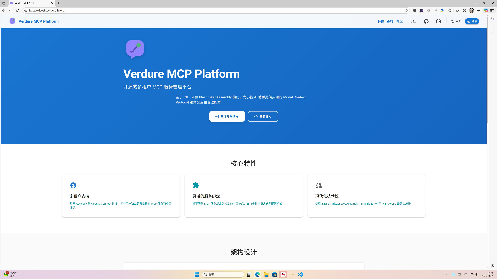

<div align="center">
  

  # Verdure MCP Platform

  > An open-source multi-tenant MCP service management platform that provides unified Model Context Protocol configuration and routing for multiple AI assistants.

  [](https://dotnet.microsoft.com/)
  [](https://dotnet.microsoft.com/apps/aspnet/web-apps/blazor)
  [](https://mudblazor.com/)
  [](./LICENSE)

  [中文说明](./README.md) · [Live Service](#-live-service) · [Quick Start](#-quick-start) · [Workflow](#-workflow) · [Community](#-community-and-support)
</div>

---

## 🌟 Live Service

Try the platform immediately without local installation.

🔗 **Primary entry**: [https://hub.verdure-hiro.cn/](https://hub.verdure-hiro.cn/)

🔗 **Compatible legacy domain**: [https://xiaozhi.verdure-hiro.cn/](https://xiaozhi.verdure-hiro.cn/)

- Free registration and instant access
- Fully hosted in the cloud
- Continuously maintained and updated

<div align="center">
  
  <p><i>Platform screenshot</i></p>
</div>

---

## 📖 Overview

Verdure MCP Platform is an enterprise-grade multi-tenant SaaS platform built with .NET 10 and Blazor WebAssembly. It provides a unified way to configure, manage, and expose Model Context Protocol (MCP) services to different AI assistants.

### Core capabilities

- Multi-tenant authentication based on Keycloak OpenID Connect
- Per-user assistant connection management for assistants such as Xiaozhi and Tuya
- Flexible binding between MCP services and assistant endpoints
- WebSocket-based MCP routing and session management
- Repository-pattern based data access with DDD-inspired layering
- PostgreSQL and SQLite support

## 🆕 Recent Updates

- Unified public entry is now available at [https://hub.verdure-hiro.cn/](https://hub.verdure-hiro.cn/)
- The legacy domain remains supported for compatibility
- The connection layer now supports multiple assistant types, including Tuya
- The project has contributed a C# SDK to the Tuya ecosystem: [tuya/tuya-mcp-sdk](https://github.com/tuya/tuya-mcp-sdk)

## ✨ Key Features

### Multi-tenant and secure

- Keycloak-based OpenID Connect authentication
- User-level isolation for assistants, services, and bindings
- Multiple authentication modes for MCP services: Bearer, Basic, OAuth2, and API Key

### Flexible service binding

- Configure multiple MCP services per tenant
- Bind services dynamically to specific assistant nodes
- Select tools per binding instead of exposing everything blindly
- Automatic reconnection and failure recovery for WebSocket sessions

### Modern stack

- .NET 10 Web API backend
- Blazor WebAssembly frontend
- MudBlazor UI components
- .NET Aspire for local orchestration
- Entity Framework Core for persistence

### Architecture

- Frontend and backend separation
- Repository pattern
- Domain-driven design structure
- Internationalization support for Chinese and English

## 🏗️ Project Structure

```text
verdure-mcp-for-xiaozhi/
├── src/
│   ├── Verdure.McpPlatform.AppHost/           # Aspire host
│   ├── Verdure.McpPlatform.ServiceDefaults/   # Shared service configuration
│   ├── Verdure.McpPlatform.Api/               # Web API
│   ├── Verdure.McpPlatform.Web/               # Blazor WebAssembly frontend
│   ├── Verdure.McpPlatform.Domain/            # Domain layer
│   ├── Verdure.McpPlatform.Infrastructure/    # Infrastructure layer
│   ├── Verdure.McpPlatform.Application/       # Application layer
│   └── Verdure.McpPlatform.Contracts/         # Shared contracts and DTOs
└── tests/                                     # Test projects
```

For architecture and coding conventions, see [agents.md](./agents.md).

## 🚀 Quick Start

### Option 1: Use the hosted service

Open [https://hub.verdure-hiro.cn/](https://hub.verdure-hiro.cn/) and start using the platform directly.

### Option 2: Local Docker deployment

This is the fastest self-hosted path and includes PostgreSQL, Redis, Keycloak, and the application stack.

#### Prerequisites

- Docker Desktop on Windows or macOS, or Docker Engine plus Docker Compose on Linux
- PowerShell 5.1+ or PowerShell 7+

#### Start locally

```powershell
git clone https://github.com/maker-community/verdure-mcp-for-xiaozhi.git
cd verdure-mcp-for-xiaozhi
./scripts/start-local.ps1
```

#### Local endpoints

- Application: http://localhost:5241
- Keycloak admin: http://localhost:8080

#### Demo accounts

- Admin: admin / admin123
- Demo user: demo / demo123

#### Common commands

```powershell
./scripts/health-check.ps1
./scripts/view-logs.ps1
./scripts/stop-local.ps1
```

Docker-specific details are available in [docker/README.md](./docker/README.md).

### Option 3: .NET development environment

Use this path if you want to modify the codebase.

#### Prerequisites

- .NET 10 SDK
- PostgreSQL or SQLite
- Redis for distributed features
- Keycloak for authentication flows

#### Setup

```bash
git clone https://github.com/maker-community/verdure-mcp-for-xiaozhi.git
cd verdure-mcp-for-xiaozhi
dotnet restore
```

Update [src/Verdure.McpPlatform.Api/appsettings.json](./src/Verdure.McpPlatform.Api/appsettings.json) with valid connection strings.

```json
{
  "ConnectionStrings": {
    "Redis": "localhost:6379",
    "mcpdb": "",
    "identitydb": ""
  }
}
```

Run the full stack through Aspire:

```bash
dotnet run --project src/Verdure.McpPlatform.AppHost
```

Or run services separately:

```bash
dotnet run --project src/Verdure.McpPlatform.Api
dotnet run --project src/Verdure.McpPlatform.Web
```

#### Default development URLs

- Web UI: https://localhost:5001
- API: https://localhost:5000
- Aspire Dashboard: https://localhost:17181

## 🎯 Workflow

1. Sign in with your account, or register on the hosted platform.
2. Add an assistant connection from the Assistant Connections page.
3. Create one or more MCP services with the required authentication mode.
4. Bind the target services to a specific assistant endpoint and choose the tools to expose.
5. Use the bound capabilities from your assistant client.

## ❓ FAQ

### What is MCP?

Model Context Protocol is an open standard that allows AI assistants to access external tools and data sources through a consistent interface.

### Is the hosted service free?

Yes. The public hosted service is currently available for free, and the codebase is also open source for self-hosting.

### What kinds of MCP services are supported?

Any service that follows the MCP protocol can be integrated, including file system tools, databases, HTTP APIs, smart-home controllers, and custom tools.

### Can I use this commercially?

Yes. The project is licensed under MIT.

## 📚 Documentation

- [agents.md](./agents.md): project architecture, conventions, and agent guidance
- [docker/README.md](./docker/README.md): Docker deployment instructions
- [docs/architecture](./docs/architecture): architecture and distributed-session documentation
- [docs/guides](./docs/guides): deployment, testing, and usage guides
- [local-packages/README.md](./local-packages/README.md): using local NuGet packages

## 🌐 Community and Support

- GitHub Issues: [Submit an issue](https://github.com/maker-community/verdure-mcp-for-xiaozhi/issues)
- GitHub Discussions: [Open a discussion](https://github.com/maker-community/verdure-mcp-for-xiaozhi/discussions)
- Bilibili: [绿荫阿广](https://space.bilibili.com/25228512)
- QQ group: 1023487000

## 🤝 Contributing

Contributions are welcome, including code, documentation, bug reports, and feature proposals.

```bash
git checkout -b feature/AmazingFeature
git commit -m "Add some AmazingFeature"
git push origin feature/AmazingFeature
```

Before opening a pull request:

- Follow the architecture and coding conventions in [agents.md](./agents.md)
- Add tests and documentation for meaningful changes
- Make sure the solution builds and relevant tests pass

## 📄 License

This project is licensed under the [MIT License](./LICENSE).

## 🙏 Acknowledgements

Thanks to these projects and technologies:

- [Microsoft .NET](https://dotnet.microsoft.com/)
- [MudBlazor](https://mudblazor.com/)
- [Keycloak](https://www.keycloak.org/)
- [Model Context Protocol](https://modelcontextprotocol.io/)
- [Entity Framework Core](https://learn.microsoft.com/ef/core/)
- [.NET Aspire](https://learn.microsoft.com/dotnet/aspire/)

---

<div align="center">

If this project is useful to you, consider giving it a star.

</div>